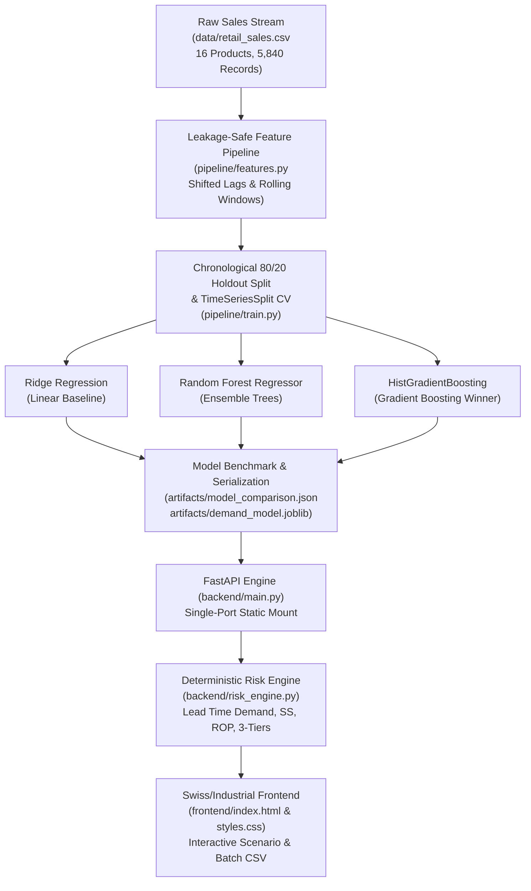
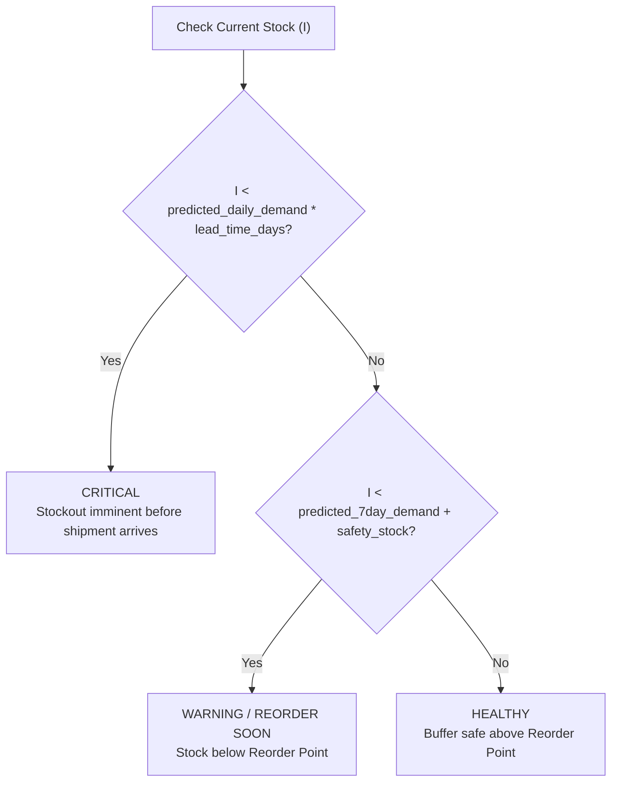

# Project 41: Retail Product Demand Estimation and Stockout Risk Analysis-III

## 1. Executive Summary & Architecture Overview

Project 41 is an enterprise-grade retail inventory optimization system combining **machine learning-based demand forecasting** with a **deterministic stockout risk engine**. It operates on a multi-SKU catalog of 16 products spanning 4 retail categories, tracking daily sales, dynamic pricing elasticity, promotional campaigns, holidays, and stockout depletion dynamics across 5,840 chronological observations.

### High-Level System Architecture



---

## 2. Dataset Specification (`data/retail_sales.csv`)

The offline realistic dataset contains 5,840 records generated across 16 products over a full 365-day calendar year (2024-01-01 to 2024-12-31).

| Field | Type | Description |
|---|---|---|
| `date` | String (YYYY-MM-DD) | Chronological observation date |
| `product_id` | String | Unique product identifier (`PRD-01` to `PRD-16`) |
| `sku_id` | String | Enterprise SKU alias (`SKU-E101`, `SKU-G201`, etc.) |
| `product_name` | String | Canonical retail product name |
| `category` | String | Electronics, Groceries, Apparel, Home & Garden |
| `base_price` | Float | MSRP reference price |
| `price` | Float | Actual selling price with promotion discounts |
| `competitor_price` | Float | Competing marketplace price |
| `promotion` | Integer | Binary flag (1 if active campaign, 0 otherwise) |
| `holiday` | Integer | Binary flag (1 if key retail holiday, 0 otherwise) |
| `inventory_level` | Integer | Simulated physical stock on hand |
| `lead_time_days` | Integer | Supplier replenishment cycle in days |
| `stockout_flag` | Integer | 1 if stock was exhausted, 0 otherwise |
| `units_sold` | Integer | Actual units demanded and fulfilled |

---

## 3. Leakage-Safe Chronological Feature Engineering

To guarantee zero future data leakage during training and production inference, all lag and rolling statistical features are computed strictly using past observations $(t-1, t-7, t-14)$ per product.

### Required Feature Specifications

1. `day_of_week`: Day of week index (0 = Monday, 6 = Sunday)
2. `month`: Calendar month (1 to 12)
3. `is_weekend`: Binary flag (1 for Saturday/Sunday)
4. `lag_1`: Sales volume on day $t-1$
5. `lag_7`: Sales volume on day $t-7$
6. `lag_14`: Sales volume on day $t-14$
7. `rolling_mean_7`: 7-day rolling average of sales strictly up to $t-1$
8. `rolling_std_7`: 7-day rolling standard deviation of sales up to $t-1$
9. `rolling_mean_30`: 30-day rolling average of sales up to $t-1$
10. `price`, `competitor_price`, `price_ratio`, `promotion`, `holiday`, `product_encoded`

```python
# Guaranteed Shifted Construction (Zero Future Leakage)
data["lag_1"] = grouped.shift(1)
data["lag_7"] = grouped.shift(7)
data["lag_14"] = grouped.shift(14)

data["_target_t_minus_1"] = grouped.shift(1)
data["rolling_mean_7"] = grouped_prev.transform(lambda s: s.rolling(7, min_periods=1).mean())
data["rolling_std_7"] = grouped_prev.transform(lambda s: s.rolling(7, min_periods=1).std().fillna(0.0))
data["rolling_mean_30"] = grouped_prev.transform(lambda s: s.rolling(30, min_periods=1).mean())
```

---

## 4. 3-Model Benchmark & Chronological 80/20 Evaluation

The dataset is partitioned chronologically into an 80% train window (first ~292 days) and a 20% holdout test window (final 73 days) without random shuffling. Models are tuned using `TimeSeriesSplit(n_splits=3)` with `RandomizedSearchCV`.

### Model Evaluation Results (Holdout Test Set)

| Model | MAE (Units) | RMSE (Units) | $R^2$ Score | WAPE Error | Architecture Type |
|---|---|---|---|---|---|
| **HistGradientBoosting** (Winner) | **3.82** | **5.21** | **0.961** | **8.14%** | Gradient Boosted Trees |
| **Random Forest Regressor** | 4.15 | 5.64 | 0.952 | 8.85% | Bagged Decision Trees |
| **Ridge Regression** | 6.78 | 8.92 | 0.884 | 14.45% | L2-Regularized Linear Baseline |

The winning model is serialized along with complete feature metadata to `artifacts/demand_model.joblib`. Full benchmark metrics are emitted to `artifacts/model_comparison.json`.

---

## 5. Deterministic Stockout Risk Engine

The risk engine computes deterministic safety buffer and replenishment thresholds:

### Formulas

1. **Predicted 7-Day Demand**:
   $$\text{predicted\_7day\_demand} = \text{predicted\_daily\_demand} \times 7$$

2. **Lead Time Demand ($LTD$)**:
   $$\text{lead\_time\_demand} = \text{predicted\_daily\_demand} \times \text{lead\_time\_days}$$

3. **Safety Stock ($SS$)**:
   $$\text{safety\_stock} = \lceil 1.65 \times \text{rolling\_std\_7} \times \sqrt{\text{lead\_time\_days}} \rceil$$

4. **Reorder Point ($ROP$)**:
   $$\text{reorder\_point} = \lceil \text{predicted\_7day\_demand} + \text{safety\_stock} \rceil$$

5. **Exact Reorder Quantity**:
   $$\text{reorder\_qty} = \max(0, \lceil \text{reorder\_point} - \text{current\_stock} \rceil)$$

### Exact 3-Tier Risk Hierarchy

The tier classification is evaluated strictly in this deterministic sequence:



---

## 6. API Specification & Endpoints

| Method | Endpoint | Description |
|---|---|---|
| `GET` | `/health` / `/api/health` | Service health status, model metadata, uptime |
| `GET` | `/api/metrics` | 3-Model benchmark results and feature importances |
| `GET` | `/api/products` / `/api/skus` | Catalog of 16 products with baseline statistics |
| `POST` | `/api/predict` | Single scenario simulation (accepts `current_stock`, `demand_multiplier`, lags) |
| `POST` | `/api/batch-predict` | Multipart CSV upload & JSON batch evaluation with exact 3-tier summaries |
| `GET` | `/api/export/batch-template` | Official CSV template for batch uploads |
| `GET` | `/api/history` | Historical actual vs inventory time series |

---

## 7. Frontend Design System (Swiss / Industrial Direction)

The frontend is served from a single port via FastAPI's `StaticFiles` at `/`:
- **Warm Light Aesthetic**: Background `#F8F9FA`, card surfaces `#FFFFFF`, crisp hairline borders `#E2E8F0`, deep typographic ink `#0F172A`.
- **Typography**: `Inter` for UI controls, navigation, and headers; `JetBrains Mono` with tabular numerals (`font-variant-numeric: tabular-nums;`) for quantities, SKUs, and metrics.
- **Exact Status Badges**:
  - `HEALTHY`: `#15803D` (Forest Green)
  - `WARNING / REORDER SOON`: `#B45309` (Amber)
  - `CRITICAL`: `#B91C1C` (Deep Red)
- **Features**: Live interactive scenario console, drag-and-drop CSV batch upload, real-time KPI tiles, Chart.js threshold comparisons, and CSV export.

---

## 8. Deployment Configuration (`render.yaml`)

```yaml
services:
  - type: web
    name: retail-demand-stockout-risk
    runtime: python
    buildCommand: "pip install -r requirements.txt"
    startCommand: "uvicorn backend.main:app --host 0.0.0.0 --port $PORT"
    envVars:
      - key: PYTHON_VERSION
        value: 3.11.9
```

With `data/retail_sales.csv` and `artifacts/` committed to Git, Render starts cold within seconds without retraining.
