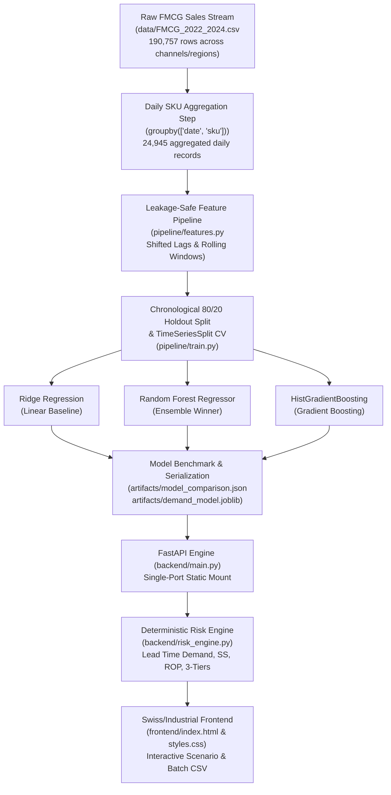

# Project 41: Retail Product Demand Estimation and Stockout Risk Analysis-III

## 1. Executive Summary & Architecture Overview

Project 41 is an enterprise-grade retail inventory optimization system combining **machine learning-based demand forecasting** with a **deterministic stockout risk engine**. It operates on the real **Kaggle FMCG Dataset (`data/FMCG_2022_2024.csv`)** covering 190,757 observations across 30 SKUs (`Milk`, `Yogurt`, `ReadyMeal`, `Juice`, `SnackBar`) from `2022-01-21` to `2024-12-31`.

### High-Level System Architecture



---

## 2. Dataset Specification (`data/FMCG_2022_2024.csv`)

The dataset contains 190,757 multi-channel, multi-region FMCG transactions from `2022-01-21` to `2024-12-31`.

### Critical Aggregation Step
Because each `(date, sku)` pair has multiple rows across channels (`Retail`, `Online`, `Wholesale`), regions (`North`, `South`, etc.), and pack types, it is aggregated to daily SKU totals before computing time-series lags:
- `units_sold`: `sum` (target variable)
- `stock_available`: `sum`
- `delivered_qty`: `sum`
- `price_unit`: `mean` (rounded to 2 decimals)
- `promotion_flag`: `max`
- `delivery_days`: `mean` (rounded to integer for default lead time)
- `brand`, `segment`, `category`: `first`

This produces **24,945 daily SKU observations** across the 30 FMCG SKUs.

---

## 3. Leakage-Safe Chronological Feature Engineering

All lag and rolling features are computed strictly using past observations $(t-1, t-7, t-14)$ per SKU:

1. `day_of_week`: Day of week index (0 = Monday, 6 = Sunday)
2. `month`: Calendar month (1 to 12)
3. `is_weekend`: Binary flag (1 for Saturday/Sunday)
4. `lag_1`: Sales volume on day $t-1$
5. `lag_7`: Sales volume on day $t-7$
6. `lag_14`: Sales volume on day $t-14$
7. `rolling_mean_7`: 7-day rolling average of sales strictly up to $t-1$
8. `rolling_std_7`: 7-day rolling standard deviation of sales up to $t-1$
9. `rolling_mean_30`: 30-day rolling average of sales up to $t-1$
10. `price_unit`, `promotion_flag`, `product_encoded`

---

## 4. 3-Model Benchmark & Chronological 80/20 Evaluation

The aggregated daily series is partitioned chronologically into an 80% train window (18,465 rows: `2022-01-21` to `2024-05-29`) and a 20% holdout test window (6,480 rows: `2024-05-30` to `2024-12-31`).

### Benchmark Results (Holdout Test Set)

| Model | MAE (Units) | RMSE (Units) | $R^2$ Score | WAPE Error | Architecture Type |
|---|---|---|---|---|---|
| **Random Forest Regressor** (Winner) | **25.13** | **32.46** | **0.4664** | **17.89%** | Bagged Ensemble Trees |
| **Ridge Regression** | 25.23 | 32.59 | 0.4619 | 17.96% | L2-Regularized Linear Baseline |
| **HistGradientBoosting** | 25.70 | 32.88 | 0.4523 | 18.30% | Gradient Boosted Trees |

The winning model is serialized to `artifacts/demand_model.joblib`, with complete comparison data in `artifacts/model_comparison.json`.

---

## 5. Deterministic Stockout Risk Engine

The risk engine computes deterministic safety buffer and replenishment thresholds:

### Formulas

1. **Predicted 7-Day Demand**:
   $$\text{predicted\_7day\_demand} = \text{predicted\_daily\_demand} \times 7$$

2. **Lead Time Demand ($LTD$)**:
   $$\text{lead\_time\_demand} = \text{predicted\_daily\_demand} \times \text{lead\_time\_days}$$

3. **Safety Stock ($SS$)**:
   $$\text{safety\_stock} = \lceil 1.65 \times \text{rolling\_std\_7} \times \sqrt{\text{lead\_time\_days}} \rceil$$

4. **Reorder Point ($ROP$)**:
   $$\text{reorder\_point} = \lceil \text{predicted\_7day\_demand} + \text{safety\_stock} \rceil$$

5. **Exact Reorder Quantity**:
   $$\text{reorder\_qty} = \max(0, \lceil \text{reorder\_point} - \text{current\_stock} \rceil)$$

### Exact 3-Tier Risk Hierarchy

1. `CRITICAL`: if $\text{current\_stock} < \text{lead\_time\_demand}$
2. `WARNING / REORDER SOON`: elif $\text{current\_stock} < \text{reorder\_point}$
3. `HEALTHY`: else $\text{current\_stock} \ge \text{reorder\_point}$

---

## 6. API Specification & Endpoints

| Method | Endpoint | Description |
|---|---|---|
| `GET` | `/health` / `/api/health` | Service health status, model metadata, uptime |
| `GET` | `/api/metrics` | 3-Model benchmark results and feature importances |
| `GET` | `/api/products` / `/api/skus` | Catalog of 30 FMCG SKUs with baseline statistics |
| `POST` | `/api/predict` | Single scenario simulation (accepts `current_stock`, `demand_multiplier`, lags) |
| `POST` | `/api/batch-predict` | Multipart CSV upload & JSON batch evaluation with exact 3-tier summaries |
| `GET` | `/api/export/batch-template` | Official CSV template for batch uploads |
| `GET` | `/api/history` | Historical actual vs inventory time series |

---

## 7. Frontend Design System (Swiss / Industrial Direction)

The frontend is served from a single port via FastAPI's `StaticFiles` at `/`:
- **Warm Light Aesthetic**: Background `#F8F9FA`, card surfaces `#FFFFFF`, crisp hairline borders `#E2E8F0`, deep typographic ink `#0F172A`.
- **Typography**: `Inter` for UI controls, navigation, and headers; `JetBrains Mono` with tabular numerals (`font-variant-numeric: tabular-nums;`) for quantities, SKUs, and metrics.
- **Exact Status Badges**:
  - `HEALTHY`: `#15803D` (Forest Green)
  - `WARNING / REORDER SOON`: `#B45309` (Amber)
  - `CRITICAL`: `#B91C1C` (Deep Red)

---

## 8. Deployment Configuration (`render.yaml`)

```yaml
services:
  - type: web
    name: retail-demand-stockout-risk
    runtime: python
    buildCommand: "pip install -r requirements.txt"
    startCommand: "uvicorn backend.main:app --host 0.0.0.0 --port $PORT"
    envVars:
      - key: PYTHON_VERSION
        value: 3.11.9
```
All artifacts in `artifacts/` are tracked so offline startup works without retraining on cold boot.
